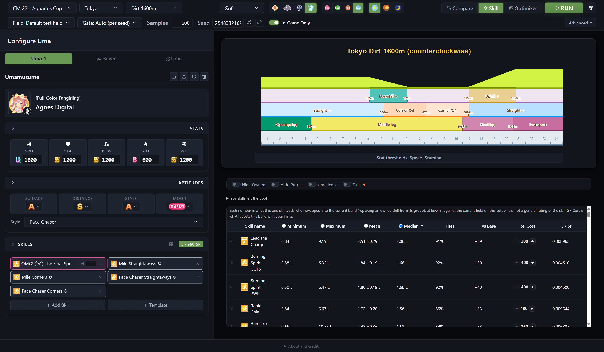

# Yet-Another-Umalator-Fork

[](https://github.com/John-UNOwen/Yet-Another-Umalator-Fork/actions/workflows/pages.yml)
[](https://github.com/John-UNOwen/Yet-Another-Umalator-Fork/actions/workflows/ci.yml)
[](uma-skill-tools/LICENSE)

Live: **https://john-unowen.github.io/Yet-Another-Umalator-Fork/**

A personal fork of [TheCing/uma-tools](https://github.com/TheCing/uma-tools) (Moomoolator), which itself is a hybrid fork of [alpha123/umalator](https://github.com/alpha123/umalator) and [kachi-dev/umalator](https://github.com/kachi-dev/umalator). The fork exists for one change: Compare and Skill modes in the v2 Global simulator run [GlobalSim](https://github.com/daftuyda/GlobalSim), a full-field Rust race engine, instead of the idealized single-uma solver. GlobalSim is vendored as an unmodified git submodule (currently v77) and compiled to WebAssembly that runs in browser Web Workers. The original engines are still selectable.



## The live site

The Pages deployment serves the v2 Global simulator at the site root. The repository's other tools (the JP simulator, HP calculator, event tracker and so on) are present in the source tree but not deployed here; the upstream project hosts those at [umalator.app](https://umalator.app/).

GitHub Pages has no server components, so two upstream features change. Screenshot OCR import needs your own Gemini API key (the shared proxy does not exist here), and the feedback form is hidden. Everything else runs client-side.

## What runs where

The engine selector sits in the header settings: GlobalSim (the default), classic v2, and classic v1. Your choice persists between visits, and a Copy Link share restores the engine the author was using; links made before the fork open classic v2.

GlobalSim mode changes what Compare and the skill chart measure:

- Every simulated race carries nine runners: the tested uma plus eight mobs from a fixed preset (`umalator-global/v2/engines/globalsim/mob-presets.json`). Compare races both builds over paired seeds and reports the full-field finish difference, win rate, ties, HP-out and rushing rates, and min/max/mean/median snapshots with representative replays.
- The skill chart reports, per skill, the mean margin with a 95% CI against the baseline build, how often the skill fired, and the resulting win rate.
- Race outcomes come from the engine's own frame data, so position, speed and HP curves in the track overlay are real full-field traces.
- Skills are gated to the engine's skill table: 751 entries (730 validated against engine v70 plus 21 supplemented, see `globalsim/skills-supplement.json`). Uncovered skills, outfits and awakenings are hidden in GlobalSim mode, and the settings panel shows how many of your skills are not yet covered.
- The Simulation threads setting sizes the worker pool. Auto uses one fewer core than your machine reports, between 1 and 8.

## Reading the numbers

Margins are horse lengths (bashin), 1 length = 2.5 meters. Positive means Uma 2 finishes ahead; this matches the classic CLI tool's `posDifference` sign convention. The 95% CI reflects how much the sampled seeds scatter; a CI that crosses zero means the margin is within seed noise at that sample size.

## Development

Prerequisites: Node.js 20+ (CI uses 22). Rust stable, the `wasm32-unknown-unknown` target and `wasm-pack` 0.15.1 are needed only when rebuilding the engine from the submodule.

```bash
npm install

# develop the app
cd umalator-global && node build.mjs --serve    # http://localhost:8000/umalator-global/v2/
npm run dev:v2                                  # the same app through the Vite dev server

# build
node umalator-global/build.mjs                  # esbuild bundles + globalsim assets
npm run build:v2                                # Vite production build to umalator-global/v2/dist

# rebuild the engine wasm (needs Rust + wasm-pack)
git submodule update --init --recursive
cd globalsim-wasm && wasm-pack build --target web --release --out-dir pkg
cd .. && node umalator-global/build.mjs         # copies pkg, geometry and the merged skill table into globalsim/
```

The asset prefix defaults to `/uma-tools`. Set `CC_BASE_PATH` at build time to change it; empty string serves assets from the site root. Every build script, the Vite configs and the dev servers honor it, and the Pages workflow fills it in from the repository name, so renaming or moving the deployment needs no code change.

### Tests

```bash
npm run test:globalsim            # adapter goldens, byte-identical request building
npm run test:globalsim-metrics    # margin math, tail grid, aggregates, CI
npm run test:globalsim-pool       # worker pool scheduling, crash and abort policy
npm run test:globalsim-mobs       # field construction, seed-derived gates
npm run test:globalsim-skills     # skill table coverage against the native engine
npm run test:globalsim-skilldata  # per-worker table injection, engine fallback guard
npm run test:globalsim-compare    # end-to-end compare through the real wasm
npm run test:globalsim-chart      # end-to-end chart through the real wasm
node globalsim-wasm/test/phase0.mjs --seeds 25   # wasm vs native byte parity
```

CI (`.github/workflows/ci.yml`) runs the engine's own `cargo test`, the parity check and these suites on every push.

### Layout

```
globalsim-wasm/                    wasm-bindgen wrapper around the engine
vendor/GlobalSim/                  the engine, unmodified submodule
umalator-global/v2/                the simulator app
  engines/globalsim/               adapter, worker core, pool, compare, chart, metrics
globalsim/                         deploy assets; skills-supplement.json is committed,
                                   wasm/ geometry/ skills.json are generated
tools/globalsim-coverage.mjs       skill coverage gate and merged table generator
docs/globalsim-upgrade.md          engine upgrade runbook
.github/workflows/                 pages.yml (deploy), ci.yml, sync-upstream-data.yml
```

## Deployment and data flow

- `pages.yml` builds the wasm, the app and the runtime assets, then deploys to GitHub Pages on every push to master.
- `sync-upstream-data.yml` runs daily, pulls alpha123's Global game data, verifies the build, and opens a pull request against master. Merging is what deploys new data. If a brand-new skill has no engine definition yet, the coverage gate step fails on the PR; `docs/globalsim-upgrade.md` describes adding a supplement entry.
- Engine version bumps follow the same runbook: bump the submodule, re-copy the request profile, rerun parity and coverage, update the version label.

## Credits

- **alpha123/umalator** by alpha123 & pecan, and **kachi-dev/umalator (VFalator)** by kachi & Jecht, for the simulator this fork builds on
- **daftuyda/GlobalSim** for the full-field race engine (pinned as a submodule; it ships without a license declaration upstream, so it is vendored unmodified and unaffiliated)
- **Skill data** from [GameTora](https://gametora.com/umamusume)
- **Game**: Uma Musume: Pretty Derby, (C) Cygames
- **Community**: [Moomoo Discord](https://discord.gg/moomoocows)

## License

GPL-3.0-or-later, see [LICENSE](uma-skill-tools/LICENSE), for this repository's code.
