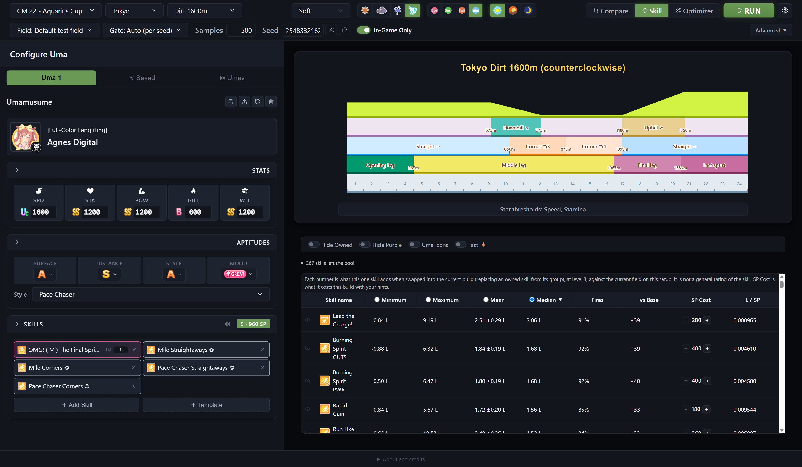

# umalator-global

The Global/English simulator, and the only part of this repo that gets deployed. Preact and
Immutable.js in TypeScript, bundled by esbuild for local work and by Vite for the site.

Live at <https://john-unowen.github.io/Yet-Another-Umalator-Fork/>. One app, three modes, all on
the GlobalSim engine: Compare (two builds over the same seeds), Skill (each skill against the
baseline build) and Optimizer (search for the best skill build within an SP budget). Every run is
a full race: the tested uma plus eight mobs from `v2/engines/globalsim/mob-presets.json`, so
position, speed, HP and the finish margin come from a real field rather than a solo run.



## Engine

GlobalSim, the Rust engine in [`../vendor/GlobalSim`](../vendor/GlobalSim), compiled to WebAssembly
by [`../globalsim-wasm`](../globalsim-wasm) and driven from
[`v2/engines/globalsim/workerCore.ts`](v2/engines/globalsim/workerCore.ts) inside
[`globalsim.worker.ts`](v2/engines/globalsim/globalsim.worker.ts). The classic TypeScript engine is
gone. [docs/globalsim-upgrade.md](../docs/globalsim-upgrade.md) covers the engine pin and its
upgrade runbook, and
[`v2/engines/globalsim/optimizer/README.md`](v2/engines/globalsim/optimizer/README.md) the search.

## Run it

Node.js 22, the version CI uses.

```bash
cd umalator-global
node build.mjs --serve          # dev server with hot reload
node build.mjs --serve 3000     # same, on another port
node build.mjs                  # bundles, and regenerates the generated data files
node build.mjs --debug          # unminified, with assertions
```

The dev server serves the repo root, so open `http://localhost:8000/umalator-global/v2/`. Shared
`icons/` and `fonts/` sit above this directory and are served too.

Vite is what CI builds and Pages deploys. From the repo root:

```bash
npm run dev:v2      # Vite dev server on http://localhost:5173
npm run build:v2    # production build to umalator-global/v2/dist
npm run preview:v2  # serve that build locally
```

The test suites are root scripts too: `npm run test:globalsim` and friends, `npm run test:optimizer`.
[../README.md](../README.md) lists all of them.

## Layout

```
umalator-global/
├── v2/                          # the app
│   ├── app-v2.tsx               # shell: mode tabs, state, URL state
│   ├── engines/globalsim/       # worker, wasm bridge, modes, optimizer
│   ├── optimizer-pane.tsx       # optimizer UI
│   ├── skill-chart-pane.tsx     # skill chart UI
│   ├── results-pane.tsx         # results and statistics
│   ├── vite.config.ts           # the deployed build
│   └── components/              # shared UI widgets
├── build.mjs                    # esbuild bundles, data generation, CM preset generation
├── skill_data.json              # skill definitions, JP superset (see the sync notes below)
├── skillnames.json              # English skill names
├── umas.json                    # characters and outfits
├── course_data.json             # race courses
├── not-in-game.json             # generated: skills and outfits not live on Global yet
└── tracknames.json              # race track names and ids
```

## Game data

`skill_data.json` is a superset of what Global ships: live Global skills plus entries
fast-forwarded from JP. Refreshing it is a merge against `../docs/master.mdb`, never a script run.
The merge rules and the drift check are in the [root CLAUDE.md](../CLAUDE.md), section "Keeping
skill_data.json in sync". The JP script `uma-skill-tools/tools/make_skill_data.pl` emits only
`modifier`/`target`/`type` per effect, so its output drops `scaling`, `wisdomCheck` and `tags` and
wipes the fast-forwarded entries. `update.bat` runs it into `skill_data.json` as its first step, so
do not run that file.

These scripts are safe and exist here:

```bash
perl make_global_skillnames.pl /path/to/master.mdb > skillnames.json
perl make_global_course_data.pl /path/to/master.mdb courseeventparams > course_data.json
perl make_global_skill_meta.pl /path/to/master.mdb > skill_meta.json
perl make_global_uma_info.pl /path/to/master.mdb
```

Perl needs `DBI` and `DBD::SQLite`. The database to read is `../docs/master.mdb`, refreshed with
`tools/pull-master-mdb.sh` at the repo root.

## Credits

Built on the work of:

- **alpha123/umalator**, original Global simulator by alpha123 and pecan
- **kachi-dev/umalator (VFalator)**, VFcord version by kachi and Jecht
- **TheCing/uma-tools (Moomoolator)**, the upstream this repo forked from
- **Skill data**, [GameTora](https://gametora.com/umamusume)
- **Game**, Uma Musume: Pretty Derby © Cygames

## License

GPL-3.0-or-later, see [LICENSE](../uma-skill-tools/LICENSE).
